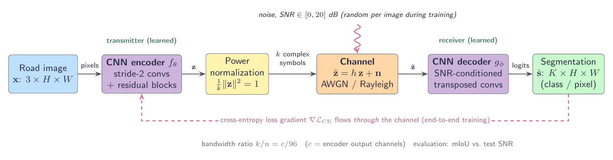
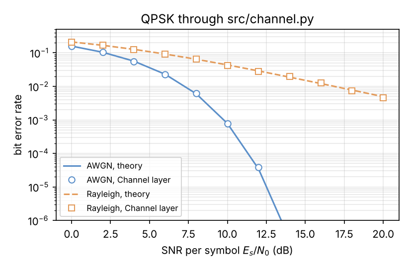

# Task-Oriented Deep JSCC for Semantic Segmentation of Road Scenes

> **Status: in progress** — architecture and channel model done, CamVid experiments next.

A connected vehicle sends camera images over a noisy wireless link to an edge server, which segments the
scene (road, car, pedestrian…). This project studies **deep joint source-channel coding (Deep JSCC)** for that
scenario: instead of compressing the image into bits (JPEG/BPG), protecting the bits (LDPC) and modulating them
(QAM), a **CNN encoder** maps the image directly to channel symbols, and a **CNN decoder** produces the
**segmentation map** from the noisy received symbols. Both are trained end to end *through* a simulated channel.

**Research question:** how does segmentation quality (**mIoU**) degrade with the channel **SNR** and the
bandwidth ratio **k/n**, compared with (A) a separate BPG + channel-coding chain and (B) a Deep JSCC trained for
image reconstruction?



## Method

| Component | Choice | File |
|---|---|---|
| Encoder $f_\theta$ | 2 stride-2 convolutions (5×5) + 2 residual blocks, BatchNorm + PReLU, no output activation | `src/model.py` |
| Power constraint | per-image normalization, $\frac{1}{k}\lVert z\rVert^2 = 1$ | `src/channel.py` |
| Channel | AWGN, block Rayleigh fading with MMSE equalization (perfect CSI) | `src/channel.py` |
| Decoder $g_\phi$ | residual blocks + 2 transposed convolutions, conditioned on the SNR | `src/model.py` |
| Bandwidth ratio | $k/n = c/96$ ($c$ = encoder output channels): 1/48, 1/24, 1/12, 1/6 | `src/model.py` |
| Training | pixel-wise cross-entropy, Adam, cosine LR, SNR ~ U[0, 20] dB per image | `src/train.py` |
| Evaluation | mIoU vs. test SNR (−5 … 20 dB), several noise draws per image | `src/evaluate.py`, `src/metrics.py` |
| Data | CamVid (11 classes), then Cityscapes (19 classes) | `src/data.py` |

## Channel validation

QPSK symbols sent through the PyTorch channel layer give the theoretical bit error rate on both AWGN and
Rayleigh channels ([notebook](notebooks/01_channel_sanity.ipynb)):



## Roadmap

- [x] System design: architecture, channel model, evaluation protocol
- [x] Differentiable AWGN / Rayleigh channel layer, validated against theoretical BER
- [x] Training and evaluation pipeline (runs on synthetic road scenes)
- [ ] CamVid: task-oriented Deep JSCC, AWGN, $c = 8$ — first mIoU vs. SNR curve
- [ ] Baseline (B): Deep JSCC for reconstruction + frozen pretrained segmenter
- [ ] Baseline (A): BPG at the capacity-limited bit budget + frozen segmenter
- [ ] Rayleigh fading and bandwidth-ratio sweep
- [ ] Short IEEE-style report

## Quick start

```bash
pip install -r requirements.txt
cd src
python channel.py                                    # power = 1, measured SNR ≈ 10 dB
python model.py                                      # tensor shapes, k/n = 1/6
python train.py --data synthetic --epochs 5 --c 8    # end-to-end check on CPU
```

CamVid (SegNet-Tutorial layout in `data/CamVid/`), GPU recommended (e.g. Google Colab):

```bash
python train.py --data camvid --root ../data/CamVid --c 8 --epochs 150 --channel awgn --out runs/camvid_c8_awgn
python evaluate.py --ckpt runs/camvid_c8_awgn/best.pt --data camvid --root ../data/CamVid
```

## References

- E. Bourtsoulatze, D. B. Kurka, D. Gündüz, "Deep joint source-channel coding for wireless image transmission," *IEEE TCCN*, 2019.
- D. Gündüz *et al.*, "Beyond transmitting bits: Context, semantics, and task-oriented communications," *IEEE JSAC*, 2023.
- J. Shao, Y. Mao, J. Zhang, "Learning task-oriented communication for edge inference: An information bottleneck approach," *IEEE JSAC*, 2022.
- T. O'Shea, J. Hoydis, "An introduction to deep learning for the physical layer," *IEEE TCCN*, 2017.
- G. J. Brostow, J. Fauqueur, R. Cipolla, "Semantic object classes in video: A high-definition ground truth database," *Pattern Recognit. Lett.*, 2009.

## Author

**Sabrine Assili** — telecommunications engineering student, ENET'Com Sfax ·
[LinkedIn](https://www.linkedin.com/in/sabrineassili74) · [GitHub](https://github.com/Sabrine74)
